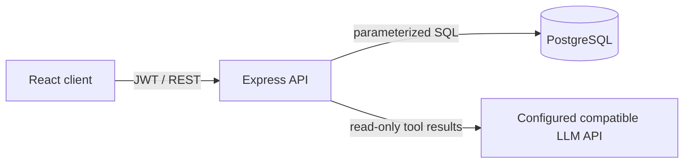

# KnowUS architecture

The API validates JWTs and reloads the user's role and employee identity from PostgreSQL. Leave decisions and balance updates run in one transaction. The AI endpoint validates the prompt and sends it to the configured provider. Provider tool calls are checked against a server-side role-specific allowlist; tool queries derive the employee ID from the authenticated user. No model-generated SQL or writes are supported. The system has no persistent AI chat history or retrieval of policy documents. Schema migrations are versioned and applied transactionally under an advisory lock.
