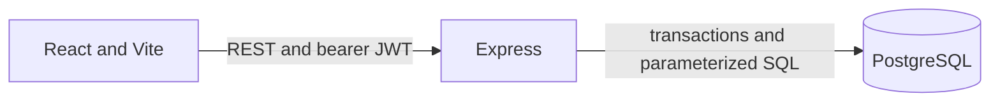

# System architecture

The API enforces authorization and writes leave decisions, balances, history, notifications and audit events transactionally. The browser stores the demo JWT in session storage. The frontend and API run independently.
